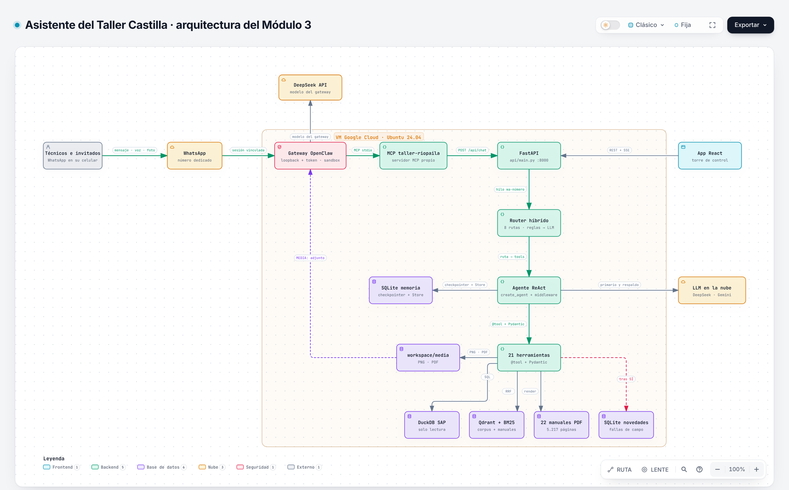
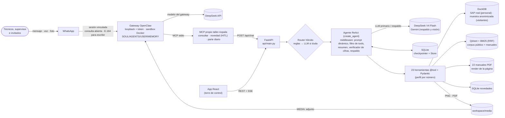
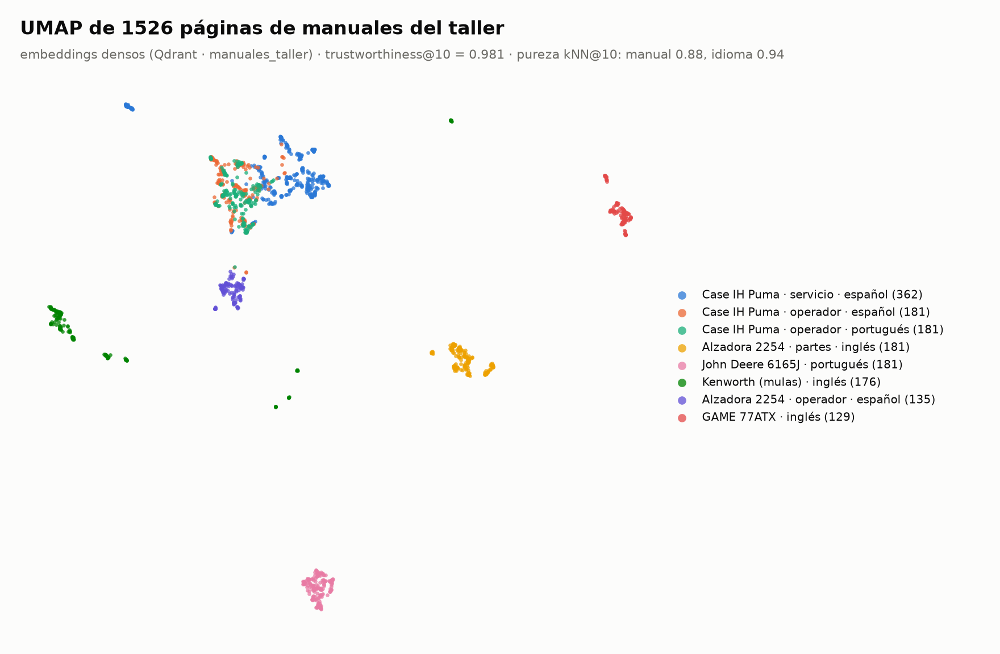
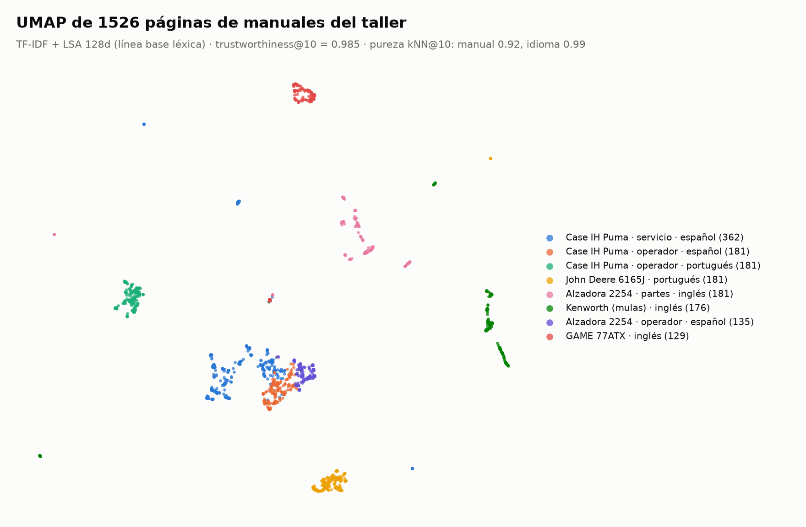
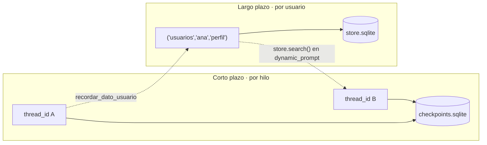

<div align="center">

# 🔧 Asistente del Taller Castilla · Riopaila Castilla

**Agente de mantenimiento por WhatsApp** que integra el Módulo 1 (corpus), el Módulo 2 (agente con RAG, memoria y
router) y el Módulo 3 (23 herramientas, OpenClaw y despliegue real) · Técnicas Avanzadas de IA aplicadas en Modelos de
Lenguaje (TAAML) · Maestría en IA y Ciencias de Datos · Universidad Autónoma de Occidente · 2026-2S · **Grupo 3**


</div>

## 📌 Problema

En el Taller Castilla (Planta Castilla de Riopaila Castilla) se mantienen cosechadoras de caña, tractores de cosecha
(7 secciones × 6 tractores: Case IH Puma, John Deere 6165J y GAME 77ATX), alzadoras John Deere 2254 y 12 tractomulas
Kenworth. El conocimiento para repararlos está disperso: **22 manuales en PDF** (5.217 páginas en español, inglés y
portugués, varios escaneados), **SAP** (15.838 equipos, 26.580 materiales y 235.498 movimientos de consumo desde 2023) y
la experiencia de los técnicos. Hoy un técnico en campo pierde tiempo buscando la página del manual, el fusible correcto
o el código SAP de un repuesto, y el supervisor se entera tarde de los consumos fuera de lo normal.

## 💡 Solución

Un **asistente por WhatsApp** (número real, abierto a cualquier invitado; lista E.164 para lo sensible) que contesta con evidencia:

| Le preguntas… | Te responde con… |
|---|---|
| “¿Qué fusible es el del radio en la mula?” | 📸 la **foto de la caja de fusibles** con el fusible **resaltado** |
| “¿Cómo cambio el filtro hidráulico del Puma 165?” | los pasos en español + 📘 **la página del manual** resaltada |
| “¿Cuánto ha gastado la cosechadora 27316?” | cifras de SAP (calculadas en Python, nunca por el LLM) + 📈 **gráfica** |
| “¿Hay consumos raros esta semana?” | ⚠️ **alertas explicables** (“30 en 30 días frente a ~2,5 esperados: 12×”) |
| “¿Qué le toca cambiar pronto al 25375?” | 🔧 **kit sugerido** con fecha estimada, costo y confianza |
| “¿Existe código SAP para la referencia 47715391?” | verificación en el maestro de materiales **antes** de pedir un código nuevo |
| 📷 *foto de una pieza* | identificación visual + candidatos de código SAP (hipótesis, pide confirmar) |
| “Mándame el informe de las cosechadoras” | 📄 **PDF** con resumen, gráfica, ranking y alertas |
| “El 25375 está botando aceite, regístralo” | 📝 **pide confirmación (SÍ/NO)** y registra la novedad; solo el personal del taller |
| 🎙️ *nota de voz* | OpenClaw la transcribe y el agente responde igual |

Y todo lo del M2 sigue vivo: preguntas sobre Riopaila Castilla con RAG y citas, cifras públicas exactas, memoria del
usuario y blindaje ante inyección. Cada mañana (6:00 a. m.) el **parte diario** llega solo por WhatsApp.

## 🏗️ Arquitectura

**Diagrama Archify** (cada componente amarrado a archivos reales del repositorio en el commit `bbdcbf3`). La versión
interactiva, con ruta, lente y zoom, es [`docs/arquitectura/arquitectura_m3.html`](docs/arquitectura/arquitectura_m3.html):
descárgala (**Download raw file**) y ábrela en el navegador.



<details>
<summary>Vista rápida en Mermaid (se dibuja en GitHub)</summary>



</details>

**Doble router.** La puerta (OpenClaw + DeepSeek) contesta saludos sin gastar herramientas y delega todo lo del
taller al MCP; adentro, el router del agente decide la ruta (`directo`, `memoria`, `rag`, `datos`, `mixto`, `taller`,
`manual`, `novedad`) y **solo habilita las herramientas de esa ruta** (`TOOLS_BY_ROUTE`). Ver
[ADR-007](docs/adr/ADR-007-openclaw-mcp-langgraph.md).

### Las 23 herramientas (`@tool` + esquema Pydantic)

| Grupo | Herramienta | Qué hace | Ruta |
|---|---|---|---|
| Flota | `buscar_equipo` · `ficha_equipo` · `flota_por_familia` · `ranking_gasto_equipos` | equipos por código o nombre, hoja de vida, flota activa por familia, top de gasto (+ gráfica) | taller |
| Consumos | `historial_consumo` · `detalle_orden` · `donde_se_usa_material` · `grafica_gasto` | movimientos 261/262/101/102 por equipo u orden, dónde se usa un repuesto, gasto mensual (+ gráfica) | taller |
| Repuestos | `buscar_repuesto` · `verificar_codigo_sap` · `repuestos_frecuentes` · `identificar_repuesto_por_foto` | búsqueda difusa (rapidfuzz), ¿la referencia ya tiene código?, lo que más se cambia por modelo, visión → SAP | taller / manual |
| Inteligencia | `detectar_anomalias` · `predecir_reposicion` · `generar_informe_pdf` | consumo ≥3× su ritmo del año anterior, próximo cambio por intervalo mediano, informe PDF | taller |
| Conocimiento | `buscar_manual` · `buscar_documentos` | página del manual con lo buscado **resaltado** (BM25 + glosario + Qdrant, RRF) · RAG del corpus público (M2) | manual · rag |
| Datos públicos | `consultar_indicadores` · `comparar_cifras` | cifras públicas de Riopaila (M2) y aritmética en Python | datos · mixto · taller |
| Vitrina (M1/M2) | `infografia_riopaila` · `grafica_indicador` | infografía *Riopaila en cifras* (panorama, energía, etanol, social) y serie por año, cada cifra con su fuente | datos · mixto |
| Memoria | `recordar_dato_usuario` | perfil de largo plazo en el Store (M2) | memoria · rag |
| Acción (HITL) | `registrar_novedad` | `interrupt` → confirmación SÍ/NO → SQLite; solo supervisor/técnico | novedad |

### Perfiles: cada quien ve lo que le corresponde

El perfil lo decide el **servidor** por el número (`TALLER_ROLES`), nunca el usuario:

| Perfil | Quién | Ve | Escribe |
|---|---|---|---|
| 🌎 `invitado` | cualquier número que escriba (visitantes, otras empresas, números ocultos) | **vitrina de Riopaila** (infografía, gráficas y documentos públicos con cita) + el taller sobre la **muestra anonimizada** (el agente lo avisa) | no |
| 🏢 `riopaila` | jefes y otras áreas de la empresa | lo anterior + **SAP real** | no |
| 🔧 `supervisor` · `tecnico` | personal del taller | todo, con SAP real | novedades con SÍ/NO |

Las herramientas de SAP eligen la base según el rol del turno (`HERRAMIENTAS_SAP`, `usa_muestra`) y un middleware
antepone el aviso de datos de muestra; las gráficas y el PDF lo llevan impreso. Ver
[ADR-011](docs/adr/ADR-011-perfiles-por-numero.md).

El servidor MCP propio (`src/riopaila_qa/mcp_taller/`) expone 3 herramientas a OpenClaw:
`consultar_asistente_taller` (solo lectura), `gestionar_novedad_taller` (escritura, habilitada solo para los números del
taller con `tools.toolsBySender`) y `parte_diario_taller`.

## 🔒 Seguridad (defensa en capas)

| Capa | Control |
|---|---|
| Canal | WhatsApp con **consulta abierta** (`dmPolicy: open`, a cualquier invitado le responde) y **lista E.164 para lo sensible**: escribir y ver SAP real; remitentes con número oculto (LID) entran como visitantes ([ADR-012](docs/adr/ADR-012-whatsapp-abierto-lid.md)); grupos deshabilitados, número dedicado |
| Gateway | `bind: loopback` + `auth.mode: token`; secretos en `~/.openclaw/.env` (fuera del repo) |
| Herramientas | `tools.profile: messaging`, `tools.deny` (runtime, fs, automation, browser…), `fs.workspaceOnly`, `exec` denegado, sin `elevated` |
| Sandbox | `agents.defaults.sandbox.mode: all` en Docker (sin red, solo lectura del workspace) |
| Permisos por remitente | `toolsBySender`: solo los números del taller ven la herramienta de escritura |
| Agente | perfil decidido por el servidor (`TALLER_ROLES`): visitantes sobre la muestra anonimizada; canal de solo lectura; **HITL** con `interrupt` antes de escribir |
| Inyección | datos pasivos en XML + detector (M2); SOUL/AGENTS con *red lines*; el LLM no calcula (verificador de cifras) |
| Datos | SAP y manuales **solo en el servidor**; el repo trae una **muestra anonimizada** (`data/taller/muestra`) |

## 📏 Evaluación

| Qué | Resultado | Cómo reproducir |
|---|---|---|
| Retrieval de manuales (25 consultas, relevancia por patrón) | léxica + glosario con RRF: **nDCG@10 0,580 · MRR 0,723 · hit@10 0,84** (vs. 0,561 / 0,687 sin glosario) | `uv run python scripts/eval_manuales.py` |
| Proyección UMAP / t-SNE (muestra estratificada de 1.526 de las 5.217 páginas) | **Embeddings reales (Qdrant):** trustworthiness@10 0,981 / 0,988; pureza kNN@10 por **familia de máquina 0,995**, por idioma 0,935, por manual 0,878. **Línea base léxica (TF-IDF):** por idioma 0,994 > por familia 0,979. → El espacio léxico agrupa por **idioma**; el denso, por **máquina** aunque el manual esté en otro idioma. Por eso la búsqueda es **híbrida** (RRF): lo denso cruza idiomas y lo léxico + glosario acierta códigos y referencias exactas | `uv run python scripts/proyeccion_embeddings.py --fuente qdrant` (en el servidor) |
| Retrieval del corpus público (M2, 28 consultas) | ver [retrieval_latest.md](docs/evaluacion/retrieval_latest.md) | `uv run python scripts/eval_retrieval.py` |
| Pruebas | pytest sin red ni LLM real (muestra anonimizada, modelo simulado, HITL de punta a punta por MCP → API → grafo, perfiles visitante/riopaila/taller) | `uv run pytest` |
| [QA end-to-end con Playwright](docs/evaluacion/QA_PLAYWRIGHT.md) | **7/7 contra la app desplegada.** API, webhook de WhatsApp (POST simulado → 200), flujo del pitch con citas y tool ejecutada, y la web en teléfono 390×844 y escritorio: consola limpia, sin 4xx/5xx; corre en el CI en cada push | `uv run pytest tests/e2e` · en el servidor: `E2E_BASE_URL=http://127.0.0.1:8000 uv run pytest tests/e2e` |

| Embeddings reales (Qdrant) | Línea base léxica (TF-IDF + LSA) |
|---|---|
|  |  |

## ⚙️ Instalación local (desarrollo)

```bash
uv sync                                                    # entorno reproducible (uv.lock)
uv run python scripts/build_taller.py --muestra            # base del taller con la muestra anonimizada
TALLER_DB=data/taller/muestra/taller_muestra.duckdb uv run fastapi dev api/main.py
cd frontend && pnpm install --frozen-lockfile && pnpm dev  # torre de control web
uv run pytest && uv run ruff check .
```

## 🚀 Despliegue (Google Cloud + OpenClaw + WhatsApp)

Guía completa paso a paso: **[docs/DESPLIEGUE_M3.md](docs/DESPLIEGUE_M3.md)**. En resumen:

```bash
bash deploy/scripts/01_preparar_servidor.sh   # paquetes, Docker, Node 24, uv, Ollama (solo embeddings), repo
bash deploy/scripts/02_cargar_datos.sh        # SAP → DuckDB, manuales + OCR, índices Qdrant
bash deploy/scripts/03_configurar_openclaw.sh # OpenClaw, workspace, openclaw.json endurecido, API, WhatsApp, cron
bash deploy/scripts/verificar.sh              # la prueba de 3 minutos del Anuncio 007
```

## 📁 Estructura

```
riopaila-castilla-qa/
├── api/                      # FastAPI: chat (SSE), hilos, memoria, RAG, /api/taller/*, /media
├── frontend/                 # React 19 + Vite + TS (torre de control web)
├── src/riopaila_qa/
│   ├── agent/                # router (8 rutas) · graph (create_agent + middleware) · service · tools · memory
│   ├── taller/               # M3: base SAP (DuckDB) · consultas · manuales · gráficas/PDF · novedades · visión · tools
│   ├── mcp_taller/           # M3: servidor MCP propio para OpenClaw
│   ├── rag/                  # M2: Qdrant + BM25 (RRF) + blindaje
│   ├── scraping/ corpus.py … # M1: pipeline Medallion
├── prompts/                  # agente_v2_taller · vision_pieza_v1 · (M1/M2 versionados)
├── deploy/                   # openclaw.json5, workspace (SOUL/AGENTS/USER/MEMORY/skill), systemd, scripts
├── data/taller/muestra/      # muestra anonimizada (CSV) para pruebas y CI
├── data/eval/                # consultas etiquetadas (corpus y manuales)
├── scripts/                  # build_taller · preparar_manuales · index_manuales · eval_manuales · proyeccion_embeddings …
├── tests/                    # pytest: taller, MCP, HITL, router, RAG, memoria, grafo y API
└── docs/                     # despliegue, manual de uso, ADRs, evaluación, arquitectura (Archify)
```

## 📚 Documentación

[Despliegue M3](docs/DESPLIEGUE_M3.md) · [Manual de uso](docs/MANUAL_USO_M3.md) · [ADRs](docs/adr/) ·
[Arquitectura (Archify)](docs/arquitectura/) · [Evaluación](docs/evaluacion/) · [Informe M2](docs/INFORME_M2.md) ·
[Informe M1](docs/INFORME.md) · [Uso de IA](docs/USO_DE_IA.md)

---

## 🧱 Lo que viene del Módulo 2

### Capacidades heredadas del Módulo 2

Un **agente conversacional** con frontend propio (React) desacoplado de un backend FastAPI que ejecuta un
grafo **LangGraph**:

| Capacidad | Cómo | Dónde |
|---|---|---|
| Memoria de corto plazo | `SqliteSaver` + `thread_id` (sobrevive al reinicio) | `agent/memory.py` |
| Memoria de largo plazo | `SqliteStore`, namespace `("usuarios", id, "perfil")`, `store.search()` | `agent/memory.py`, `agent/tools.py` |
| Contexto multi-turno | `SummarizationMiddleware` (agente) + `trim_messages` (ruta directa) | `agent/graph.py` |
| RAG documental | Qdrant (colecciones + payload + filtros + alias blue/green) + BM25, fusión **RRF** | `rag/` |
| Datos estructurados | `@tool` sobre un CSV de 36 cifras públicas con **esquema Pydantic**; la aritmética la hace Python | `structured.py` |
| Router | Gatekeeper estilo System One: reglas (Noul/Choice) → LLM con salida estructurada si hay duda | `agent/router.py` |
| Blindaje del RAG | Contexto en XML como **datos pasivos** + detector de instrucciones ocultas | `rag/shield.py` |
| Observabilidad | LangSmith (`LANGSMITH_*`) + traza JSONL por turno en `logs/trazas.jsonl` | `agent/service.py` |
| Interfaz | React 19 + Vite: streaming SSE, hilos, router visible, fuentes, errores, *time travel* | `frontend/` |


### Arquitectura del agente (Módulo 2)


#### Grafo del agente


| Ruta | Herramientas habilitadas | Ejemplo |
|---|---|---|
| `directo` | ninguna | «Hola», «¿Dónde trabajo?» |
| `memoria` | `recordar_dato_usuario` | «Me llamo Ana y trabajo en Carvajal» |
| `rag` | `buscar_documentos`, `recordar_dato_usuario` | «¿Qué es el proyecto de azúcar orgánica de RioCas?» |
| `datos` | `consultar_indicadores`, `comparar_cifras` | «¿Cuánto vendió en energía al tercer trimestre de 2023?» |
| `mixto` | las tres de datos y documentos | «Compara la meta de alcohol del documento con lo producido» |

#### Checkpointer vs. Store



El **checkpointer** guarda el estado completo de cada hilo (mensajes, decisiones del router) y permite
reanudarlo tras reiniciar el backend y hacer *time travel* (`/api/threads/{id}/checkpoints` y `/fork`).
El **Store** guarda hechos del usuario que cruzan hilos: lo que se dice en el hilo A se recupera en el B.


### Evaluación del retrieval del corpus público (M2)

28 consultas etiquetadas (`data/eval/retrieval_queries.jsonl`), relevancia binaria por documento,
comparación **densa vs. léxica vs. híbrida** con recall@10, nDCG@10 y MRR:

```bash
uv run python scripts/eval_retrieval.py      # → docs/evaluacion/retrieval_latest.md / .json
```

Los resultados vigentes están en [`docs/evaluacion/retrieval_latest.md`](docs/evaluacion/retrieval_latest.md)
y se ven en la app (pestaña **Evaluación RAG**). Detalle de diseño y decisiones en
[`docs/INFORME_M2.md`](docs/INFORME_M2.md).


### API del Módulo 2

| Método | Ruta | Para qué |
|---|---|---|
| `POST` | `/api/chat/stream` | Turno con streaming SSE: `start · route · tool_start · tool_end · token · error · final` |
| `POST` | `/api/chat` | Turno sin streaming |
| `POST` | `/api/route` | Decisión del router por reglas (depuración) |
| `GET` | `/api/threads?user_id=` | Hilos del usuario |
| `GET` / `DELETE` | `/api/threads/{id}` | Mensajes del hilo desde el checkpointer / borrar |
| `GET` / `POST` | `/api/threads/{id}/checkpoints` · `/fork` | *Time travel* |
| `GET` / `PUT` / `DELETE` | `/api/users/{id}/memory` | Perfil del Store |
| `GET` | `/api/datos/indicadores` | Filas del CSV |
| `POST` | `/api/rag/search` | Top-k denso, léxico o híbrido con filtros |
| `GET` | `/api/eval/retrieval` · `/api/health` · `/api/graph` | Evaluación, estado y diagrama del grafo |


## 👥 Créditos

- Melissa Palacios Domínguez
- Waldor Drada Arango
- Jorge Andrés Rivas Manzano (Supervisor de Mantenimiento, Planta Castilla)

Datos del taller usados con autorización de Riopaila Castilla; solo viven en el servidor del proyecto.
Code Reviewer del Grupo 3: el profesor (revisión en vivo).

## 📄 Licencia

[MIT](LICENSE) © 2026 Melissa Palacios Domínguez, Waldor Drada Arango y Jorge Andrés Rivas Manzano.
