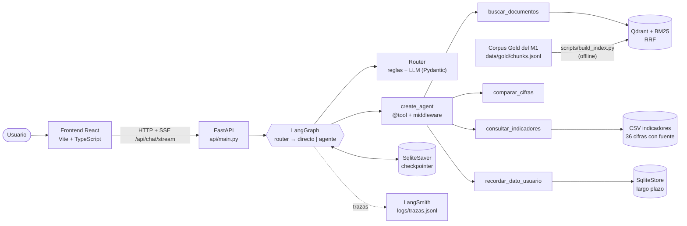
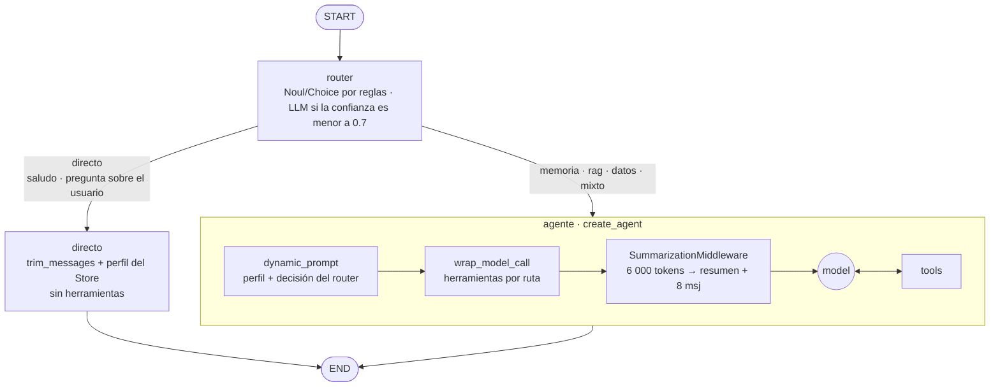
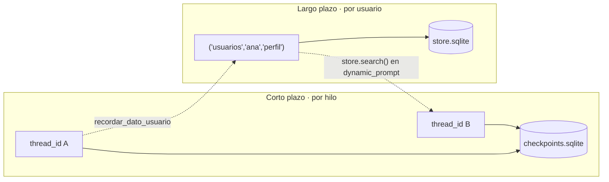

<div align="center">

# 🌾 Riopaila Castilla · Agente conversacional con memoria, RAG y router

**Módulo 2 del asistente corporativo** · Técnicas Avanzadas de IA aplicadas en Modelos de Lenguaje (TAAML)
Maestría en Inteligencia Artificial y Ciencias de Datos · Universidad Autónoma de Occidente · 2026-2S · **Grupo 3**


</div>

## 📌 Problema

Riopaila Castilla atiende públicos muy distintos (clientes de azúcar, mieles y alcohol; compradores de
energía; proveedores y cultivadores de caña; comunidades; inversionistas). En el Módulo 1 construimos su
base de conocimiento pública (173 documentos, 691 chunks) y un Q&A con citas. Faltaba un **asistente que
converse**: que recuerde a quién atiende, que distinga cuándo buscar en documentos, cuándo consultar una
cifra exacta y cuándo simplemente saludar, y que no se deje manipular por un documento contaminado.

## 💡 Solución

Un **agente conversacional** con frontend propio (React) desacoplado de un backend FastAPI que ejecuta un
grafo **LangGraph**:

| Capacidad | Cómo | Dónde |
|---|---|---|
| Memoria de corto plazo | `SqliteSaver` + `thread_id` (sobrevive al reinicio) | `agent/memory.py` |
| Memoria de largo plazo | `SqliteStore`, namespace `("usuarios", id, "perfil")`, `store.search()` | `agent/memory.py`, `agent/tools.py` |
| Contexto multi-turno | `SummarizationMiddleware` (agente) + `trim_messages` (ruta directa) | `agent/graph.py` |
| RAG documental | Qdrant (colecciones + payload + filtros + alias blue/green) + BM25, fusión **RRF** | `rag/` |
| Datos estructurados | `@tool` sobre un CSV de 36 cifras públicas con **esquema Pydantic**; la aritmética la hace Python | `structured.py` |
| Router | Gatekeeper estilo System One: reglas (Noul/Choice) → LLM con salida estructurada si hay duda | `agent/router.py` |
| Blindaje del RAG | Contexto en XML como **datos pasivos** + detector de instrucciones ocultas | `rag/shield.py` |
| Observabilidad | LangSmith (`LANGSMITH_*`) + traza JSONL por turno en `logs/trazas.jsonl` | `agent/service.py` |
| Interfaz | React 19 + Vite: streaming SSE, hilos, router visible, fuentes, errores, *time travel* | `frontend/` |

## 🏗️ Arquitectura



### Grafo del agente



| Ruta | Herramientas habilitadas | Ejemplo |
|---|---|---|
| `directo` | ninguna | «Hola», «¿Dónde trabajo?» |
| `memoria` | `recordar_dato_usuario` | «Me llamo Ana y trabajo en Carvajal» |
| `rag` | `buscar_documentos`, `recordar_dato_usuario` | «¿Qué es el proyecto de azúcar orgánica de RioCas?» |
| `datos` | `consultar_indicadores`, `comparar_cifras` | «¿Cuánto vendió en energía al tercer trimestre de 2023?» |
| `mixto` | las tres de datos y documentos | «Compara la meta de alcohol del documento con lo producido» |

### Checkpointer vs. Store



El **checkpointer** guarda el estado completo de cada hilo (mensajes, decisiones del router) y permite
reanudarlo tras reiniciar el backend y hacer *time travel* (`/api/threads/{id}/checkpoints` y `/fork`).
El **Store** guarda hechos del usuario que cruzan hilos: lo que se dice en el hilo A se recupera en el B.

## 📏 Evaluación del retrieval

28 consultas etiquetadas (`data/eval/retrieval_queries.jsonl`), relevancia binaria por documento,
comparación **densa vs. léxica vs. híbrida** con recall@10, nDCG@10 y MRR:

```bash
uv run python scripts/eval_retrieval.py      # → docs/evaluacion/retrieval_latest.md / .json
```

Los resultados vigentes están en [`docs/evaluacion/retrieval_latest.md`](docs/evaluacion/retrieval_latest.md)
y se ven en la app (pestaña **Evaluación RAG**). Detalle de diseño y decisiones en
[`docs/INFORME_M2.md`](docs/INFORME_M2.md).

## ⚙️ Instalación

Requisitos: [uv](https://docs.astral.sh/uv/), [Node.js 22 LTS](https://nodejs.org) con `pnpm`
(`npm install -g pnpm`), [Ollama](https://ollama.com) para los embeddings y una API key de Gemini.

```bash
git clone https://github.com/JORGE-RIVAS19/riopaila-castilla-qa.git
cd riopaila-castilla-qa
uv sync                                   # backend: versiones exactas de uv.lock
cp .env.example .env                      # Windows: copy .env.example .env  → poner GOOGLE_API_KEY
ollama pull nomic-embed-text-v2-moe       # embeddings locales (768 dims)
uv run python scripts/build_index.py      # indexación offline en Qdrant (data/qdrant)
cd frontend && pnpm install && cd ..
```

## ▶️ Uso

```bash
# Terminal 1 · backend del agente (docs interactivas en http://127.0.0.1:8000/docs)
uv run fastapi dev api/main.py

# Terminal 2 · frontend propio (http://localhost:5173)
cd frontend && pnpm dev

# Utilidades
uv run python scripts/eval_retrieval.py   # recall@10 / nDCG@10
uv run python scripts/build_index.py --rollback   # blue/green: volver a la colección anterior
uv run ruff check . && uv run pytest      # calidad backend (sin red ni LLM)
cd frontend && pnpm test && pnpm build    # calidad frontend
```

El pipeline de scraping del Módulo 1 sigue disponible: `uv run python scripts/scrape_empresa.py`.

## 🔌 API

| Método | Ruta | Para qué |
|---|---|---|
| `POST` | `/api/chat/stream` | Turno con streaming SSE: `start · route · tool_start · tool_end · token · error · final` |
| `POST` | `/api/chat` | Turno sin streaming |
| `POST` | `/api/route` | Decisión del router por reglas (depuración) |
| `GET` | `/api/threads?user_id=` | Hilos del usuario |
| `GET` / `DELETE` | `/api/threads/{id}` | Mensajes del hilo desde el checkpointer / borrar |
| `GET` / `POST` | `/api/threads/{id}/checkpoints` · `/fork` | *Time travel* |
| `GET` / `PUT` / `DELETE` | `/api/users/{id}/memory` | Perfil del Store |
| `GET` | `/api/datos/indicadores` | Filas del CSV |
| `POST` | `/api/rag/search` | Top-k denso, léxico o híbrido con filtros |
| `GET` | `/api/eval/retrieval` · `/api/health` · `/api/graph` | Evaluación, estado y diagrama del grafo |

## 📁 Estructura

```
riopaila-castilla-qa/
├── api/                      # FastAPI: main.py (endpoints + SSE) · schemas.py (contratos Pydantic)
├── frontend/                 # React 19 + Vite + TS: páginas, componentes, cliente SSE, Vitest
├── src/riopaila_qa/
│   ├── agent/                # settings · embeddings · memory · router · tools · graph · service · fakes
│   ├── rag/                  # documents (limpieza) · index (Qdrant) · retriever (RRF) · shield
│   ├── structured.py         # CSV de indicadores + consultas deterministas (Pydantic)
│   ├── scraping/ corpus.py … # Módulo 1: pipeline Medallion y BM25
├── prompts/agente_v1.md      # prompt de sistema del agente (versionado)
├── data/
│   ├── gold/                 # corpus del M1 (entrada del índice)
│   ├── structured/           # indicadores_riopaila.csv (cifras públicas con URL de origen)
│   ├── adversarial/          # documento sintético para el caso 5 (blindaje)
│   ├── eval/                 # 24 preguntas del M1 + 28 consultas etiquetadas del retrieval
│   ├── qdrant/ memory/       # índice y memoria locales (no se versionan)
├── scripts/                  # build_index · eval_retrieval · scrape_empresa · run_eval
├── tests/                    # pytest: datos, router, blindaje, RAG, memoria, grafo y API
├── docs/                     # INFORME_M2 · GUION_M2 · ADRs · evaluación
└── openspec/                 # especificaciones (SDD) del M1 y del M2
```

## 🔒 Ética, seguridad y datos

- El corpus es solo contenido público (M1: robots.txt, sin sitemap de usuarios, Ley 1581).
- El CSV usa **solo cifras publicadas por la empresa** en sus noticias, cada fila con su URL.
- El documento de `data/adversarial/` es **sintético** y está marcado `origen=sintetico`: existe solo
  para demostrar el blindaje; la app lo señala como “documento de prueba”.
- `.env`, API keys, `data/qdrant/`, `data/memory/` y `logs/` nunca entran al repositorio.

## 📚 Documentación

[Informe M2](docs/INFORME_M2.md) · [Guion de la sustentación M2](docs/GUION_M2.md) ·
[ADRs](docs/adr/) · [Evaluación del retrieval](docs/evaluacion/retrieval_latest.md) ·
[Especificación M2](openspec/changes/modulo2-agente/proposal.md) · [Informe M1](docs/INFORME.md) ·
[Uso de IA](docs/USO_DE_IA.md)

## 👥 Créditos

- Melissa Palacios Domínguez
- Waldor Drada Arango
- Jorge Andrés Rivas Manzano

Code Reviewer del Grupo 3: el profesor (revisión en vivo).

## 📄 Licencia

[MIT](LICENSE) © 2026 Melissa Palacios Domínguez, Waldor Drada Arango y Jorge Andrés Rivas Manzano.
